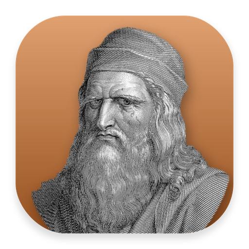
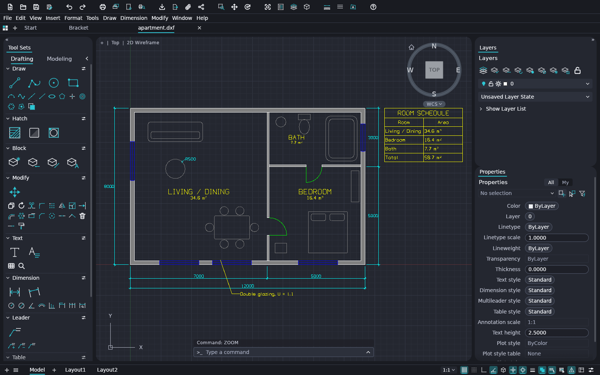
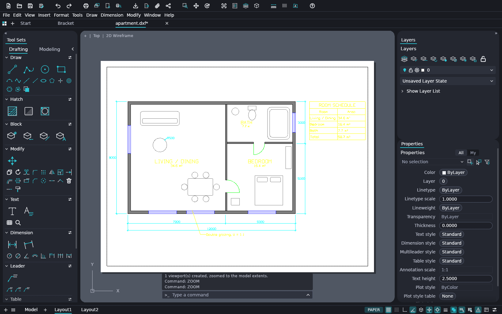
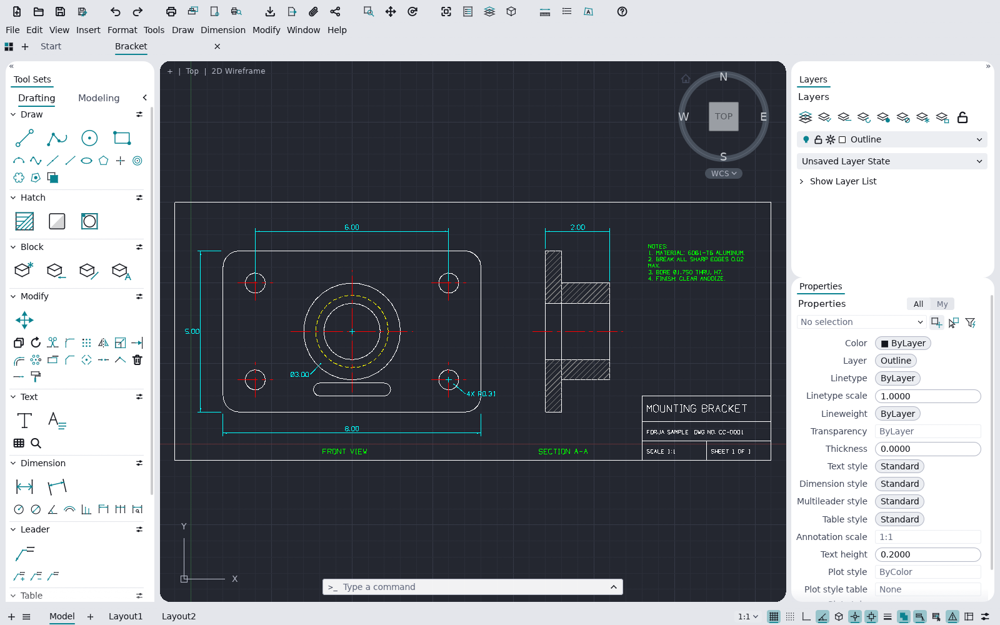

<div align="center">
  <a href="https://getnodalia.com">
    <picture>
      <source media="(prefers-color-scheme: dark)" srcset="https://raw.githubusercontent.com/danielmigueltejedor/nodalia-web/main/assets/brand/nodalia-wordmark-white.svg">
      
    </picture>
  </a>
  <br><br>
  
  <h1>Forja</h1>
  <p><strong>A native CAD application for 2D drafting and DWG/DXF drawings, part of the Nodalia suite.</strong></p>

  <p>
    
    
    
    
  </p>

  <p>
    <a href="#screenshots">Screenshots</a> ·
    <a href="#what-it-does">What it does</a> ·
    <a href="#build-and-run">Build</a> ·
    <a href="#agents-and-the-command-line">Agents</a> ·
    <a href="#project-status">Status</a> ·
    <a href="#the-nodalia-suite">Suite</a> ·
    <a href="#license">License</a>
  </p>
</div>

<p align="center">
  
  <br><sub><b>Apartment plan</b> (<a href="examples/apartment.dxf">examples/apartment.dxf</a>): hatched walls, room labels, a table, a multileader and dimensions, all drawn with Forja's own commands.</sub>
</p>

---

## Overview

**Forja** is the CAD application of [Nodalia](https://getnodalia.com). You draft the way decades of
habit expect: type `L`, click two points, type `@5<45`, press Enter. It opens and saves DXF and DWG,
lays drawings out on paper, and plots them to PDF. It is written in Rust, with no Electron and no web
view, and it wears Nodalia Design: rounded islands, bold icons and the suite's own window controls on
Linux.

> [!IMPORTANT]
> **Forja is at an early stage.** The first release, 0.1.0, targets Linux. Expect rough edges, and
> keep a copy of drawings that matter.

## Screenshots

<table>
  <tr>
    <td width="50%"></td>
    <td width="50%"></td>
  </tr>
  <tr>
    <td><sub><b>Layouts</b>: paper space with viewports, page setups and plotting to PDF.</sub></td>
    <td><sub><b>Light theme</b>: a two-view part drawing with centre lines, a section hatch and a title block.</sub></td>
  </tr>
</table>

## What it does

- **The command line you know.** Prompts with clickable keywords, AutoComplete, aliases, relative
  and polar input (`@dx,dy`, `@d<a`), direct distance entry, object snaps, polar tracking, ortho,
  window and crossing selection, grips, and Enter or right-click to repeat.
- **Drafting and editing.** Lines, polylines, circles, arcs, rectangles, polygons, ellipses,
  splines, text and multiline text; move, copy, rotate, scale, mirror, stretch, offset, trim,
  extend, fillet, chamfer, arrays and more.
- **Annotation.** Dimensions with full dimension styles that follow the geometry, multileaders,
  tables, hatches and gradients, blocks with attributes, TrueType fonts and a single-stroke
  drafting font of its own.
- **Layers and properties.** A layers palette and manager, layer tools, and a properties palette
  that edits any selection.
- **Open files.** DXF read and write, DWG open and save, PDF plotting, SVG and PNG export.
- **Layouts and plotting.** Paper-space layouts, scaled and locked viewports, page setups.
- **Parametric drawing.** Geometric and dimensional constraints that re-solve after every edit.
- **Many languages.** English, Spanish and seventeen more interface languages, switched live
  ([details](docs/localization.md)).

The full, honest list of what works and what does not yet is in [ROADMAP.md](ROADMAP.md) and
[docs/gaps.md](docs/gaps.md).

## Build and run

You need Rust 1.95 or later.

```bash
git clone https://github.com/danielmigueltejedor/forja.git
cd forja
cargo run --release -p forja -- --sample      # opens the sample drawing
```

Then type at the command line:

```text
line 0,0 @10,0 @0,5 c          a closed triangle
circle 5,2 1                    a circle
zoom e                          zoom to the drawing
```

Forja keeps its settings and its log in `~/.config/forja/` on Linux.

## Agents and the command line

Every menu item, tool and prompt is a command, so scripts and agents can do anything a person can:

```bash
forja-cli mcp                                    # MCP server on stdio
forja-cli info drawing.dxf                       # what is in a drawing
forja-cli convert drawing.dwg drawing.svg        # convert or export
forja-cli run --sample --script 'CIRCLE 22,3 1\n' --save out.dxf --export out.png
```

The desktop app also takes a JSON control channel (`--control PORT`). See [docs/cli.md](docs/cli.md),
[docs/mcp.md](docs/mcp.md) and [docs/control-protocol.md](docs/control-protocol.md).

## Project status

| Area | State |
|---|---|
| Drafting, editing, annotation | Working; see [ROADMAP.md](ROADMAP.md) |
| DXF and DWG | Open and save; some entities are not kept yet ([file-format-parity.md](docs/file-format-parity.md)) |
| Nodalia Design interface | Done: islands, NDL icons and dialogs, Linux window controls |
| Native window controls | macOS and Windows keep the system's own |
| Installable packages | 0.1.0 for Linux, about to be published |

## App icon

Nodalia app icons are black-and-white portraits of historical figures over the app colour.
Forja's is Leonardo da Vinci, engineer and master of technical drawing. Provenance and licence are
in [`assets/app-icon/`](assets/app-icon/).

## The Nodalia suite

Forja is one of the applications of [Nodalia](https://getnodalia.com), an independent software
project developed in public by [Daniel Miguel Tejedor](https://danielmigueltejedor.com).

## License

`MIT OR Apache-2.0`. See [`LICENSE-MIT`](LICENSE-MIT), [`LICENSE-APACHE`](LICENSE-APACHE) and
[`NOTICE`](NOTICE). Every asset and its source is listed in [`ATTRIBUTION.md`](ATTRIBUTION.md).
